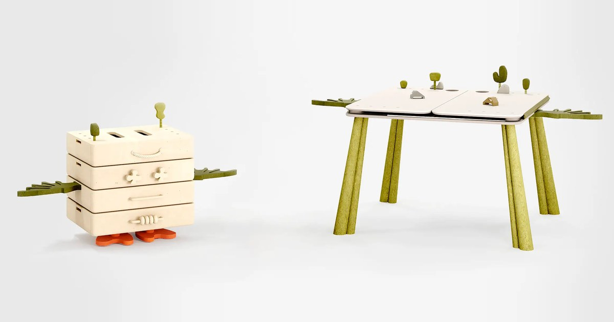

# Halyapina

The portfolio website of furniture designer Maria Halyapina: [halyapina.com](https://www.halyapina.com).

I built it in 2023–2024 as a side project, and the site has been live since.



## Features

- **Home page.** Hand-drawn project cards that switch to another drawing on hover.
- **Project pages.** Nine furniture and lighting projects, each with an image slider and full-screen zoom.
- **About and Anima pages.** The designer's story and a long-read about one project.
- **Two languages.** Russian and English through vue-i18n; the chosen language is remembered.
- **Phones.** A separate layout for small screens, WebP images, lazy loading of the heavy ones.

## Tech stack

Vue 3, Vite, Vuetify 3, Vue Router, vue-i18n, Swiper, Splide, v-lazy-image.

## Getting started

```bash
npm install
```

```bash
npm run dev
```

The dev server starts on port 3000. `npm run build` writes the production build to `dist`.
